# The look gate: two builds, the same screens, three questions

Stage 2 ends here, before anything is deleted. The look was chosen on paper (The Pass) and disliked when built, and the brief then chose Data Book on paper. So this page shows two built things. It does not say which is better, and no agent has answered the three questions below. The owner answers them.

- **Build A** is the tag `wave-r-stage1`, which is the commit `094089c` (branch `look-a`). The tag exists only in the clone that made it; the commit is in the branch's history, so a clone without the tag uses the commit. It holds the new names, the way on, the lesson template and the frame, under The Pass, with the kitchen whole.
- **Build B** is `wave-r` at `4cccff2`, the head of stage 2: the same, under Data Book.

Ten pairs follow: five screens at 1440 x 900 and at 390 x 844. Each pair is the same route, the same keys and clicks and the same viewport, from a fresh browser with nothing stored. Each image is the viewport, cropped to it, and its caption names the build's SHA. Five of the images are held under 300 KB by a 256-colour palette; the rest are the browser's own PNG.

## 1. See both, side by side

Two ports, two scratch worktrees (this checkout is not touched), both served from `dist/` by `vite preview`:

```
bun scripts/look-gate.ts serve      # builds both, then serves A on :4301 and B on :4302 until stopped
bun scripts/look-gate.ts clean      # removes the two scratch worktrees afterwards
```

By hand, the same thing:

```
git worktree add --detach ../enginespace-build-a wave-r-stage1   # or 094089c, where the clone has no such tag
git worktree add --detach ../enginespace-build-b wave-r
for b in a b; do (cd ../enginespace-build-$b && cp -al ../enginespace/node_modules node_modules && npm run build); done
(cd ../enginespace-build-a && npx vite preview --port 4301 --strictPort) &
(cd ../enginespace-build-b && npx vite preview --port 4302 --strictPort) &
```

The images come from `bun scripts/look-gate.ts shoot` with both serving (`ES_CHROMIUM` names a Chromium when Playwright's own cannot start). `docs/waves/wr-look/shots.json` records each image's route, viewport, build SHA, what was pressed and its size.

## 2. The same in both builds

- **Names.** Every game, level, control and nav word is the engine's term: Step loop, KV page pool, Waiting queue, Batch slots, Async scheduling.
- **The way on.** The same header (Course, Games, Review, Progress, and the Start control), the same next-step controls and the same words for where you are.
- **The lesson template.** TR5a lesson 1 has the same sections (Run, Read, Test, Keep), the same prose and the same figures.
- **The frame, on the KV page pool.** The same instrument frame in both: title and role line, goal line, diagram, readout and the first-run intro, with Parts, How to play and Keyboard.

## 3. What differs

- **Surfaces.** A: brushed steel, paper cards and stamped labels. B: flat paper on a graticule, hairline rules and one amber for the next move.
- **Faces.** A sets three more faces (Doto, Handjet, Permanent Marker) beside the two that both share. B uses Big Shoulders Display for headings and Atkinson Hyperlegible, with its mono, for the rest.
- **The step loop, 2D.** A has engine words on the kitchen drawing, in the older page shell, and not yet in the frame. B has the frame, with the timing diagram. The timing diagram has the waiting queue, CPU lane, one row for each batch slot, ticks across, the idle gap marked as a dimension line.
- **The step loop, 3D.** A shows the kitchen scene. B shows the time track, the timing diagram stood up in 3D. B draws no kitchen for the step loop: the kitchen's scene left B's tree when the front page was rebuilt, since that page was its last importer. Every other kitchen file is still in B's tree until stage 4.
- **The front page.** A is the kitchen with a panel over it. B is a heading and a live timing diagram beside it, in 2D first, with 3D one tap away on a desk and none on a phone.
- **The pool and the lesson.** The same content, laid out alike. They differ mostly in surface and face, so their pairs are the closest.
- **One disclosure.** No concept roll was dealt for Data Book; the brief's judges chose it. Accepting the brief's choice in its place, or asking for a roll to be dealt and recorded before the design file is written, is the owner's call. On 2026-11-16 the owner chose Data Book with this disclosure on the page, in the words "data book for sure", and did not ask for a roll.

## 4. The ten pairs

### 1. The front page at first paint

Route `/`. Nothing pressed: a first visit, once the fonts are in and the scene has loaded.

**1440 x 900**

| Build A, The Pass | Build B, Data Book |
|---|---|
| 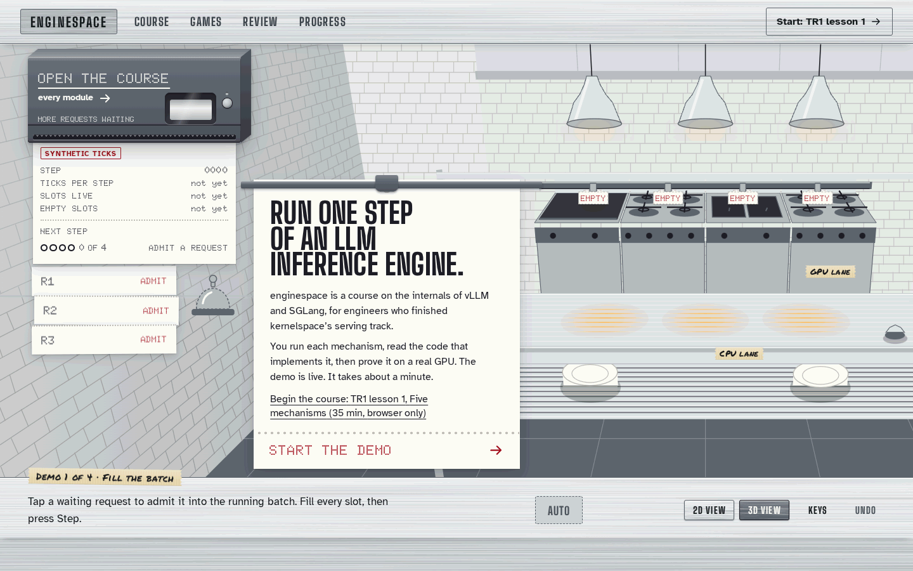<br>Build A, `094089c` | 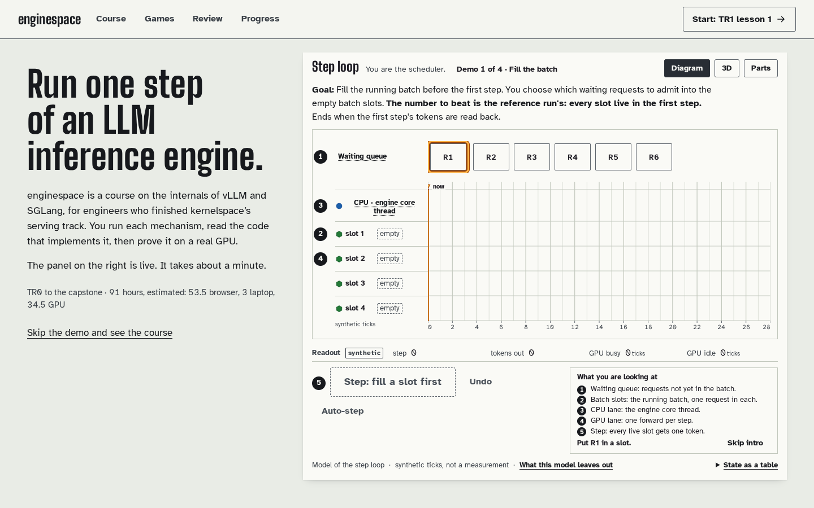<br>Build B, `4cccff2` |

**390 x 844**

| Build A, The Pass | Build B, Data Book |
|---|---|
| 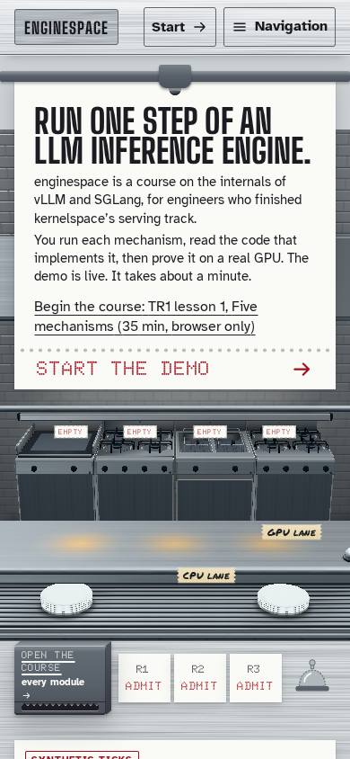<br>Build A, `094089c` | 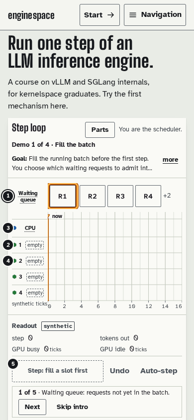<br>Build B, `4cccff2` |

### 2. The front page after one step, in 3D

Route `/`. R1 and R2 admitted, then Step. The 3D view is on wherever the build offers it. Build B offers no 3D to a phone, so its 390 image is the 2D view and says so.

**1440 x 900**

| Build A, The Pass | Build B, Data Book |
|---|---|
| 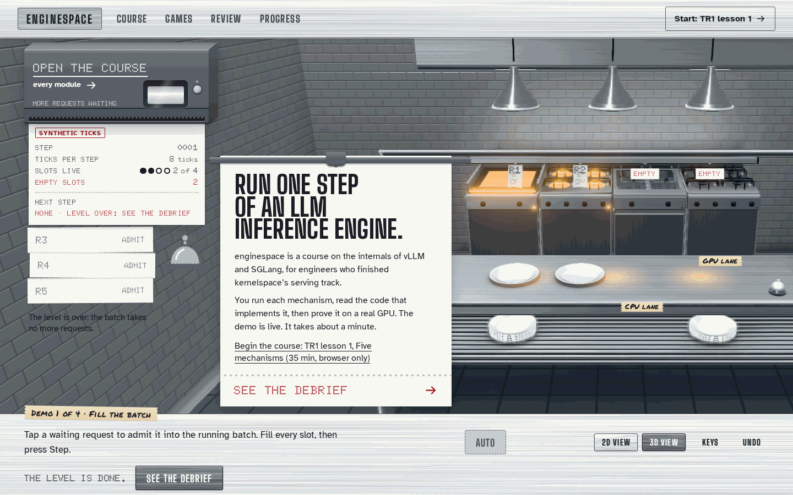<br>Build A, `094089c` | 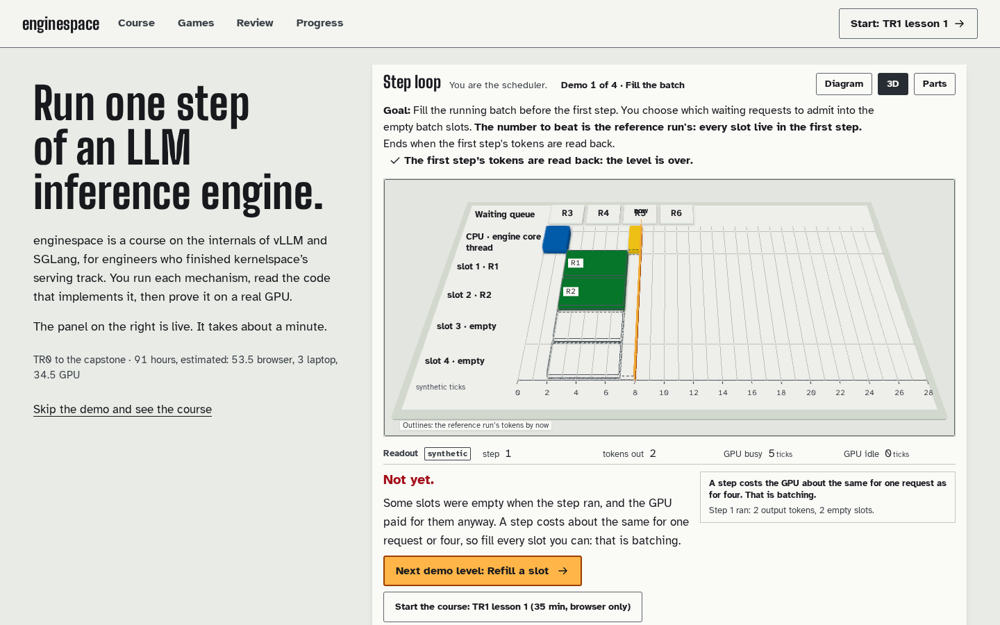<br>Build B, `4cccff2` |

**390 x 844**

| Build A, The Pass | Build B, Data Book |
|---|---|
| 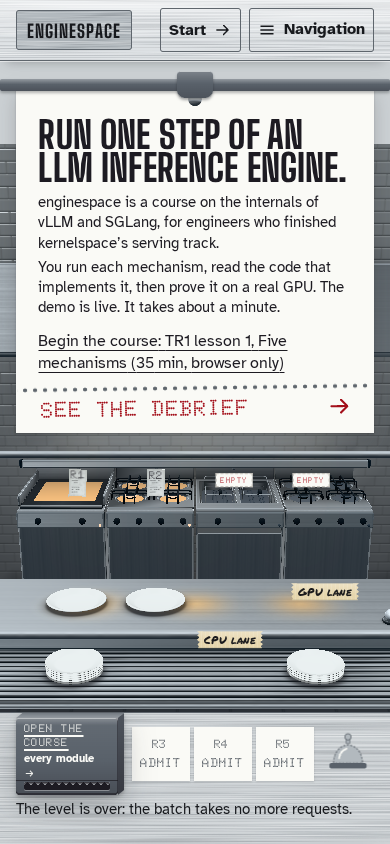<br>Build A, `094089c` | 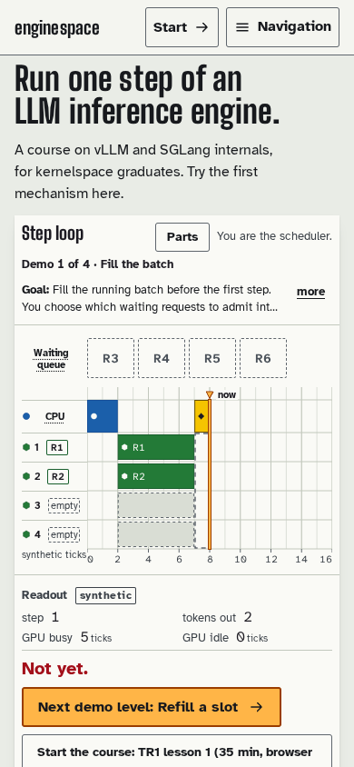<br>Build B, `4cccff2` |

### 3. The KV page pool at its first run

Route `/play/pool`. A first visit, so the first-run intro is on the diagram.

**1440 x 900**

| Build A, The Pass | Build B, Data Book |
|---|---|
| 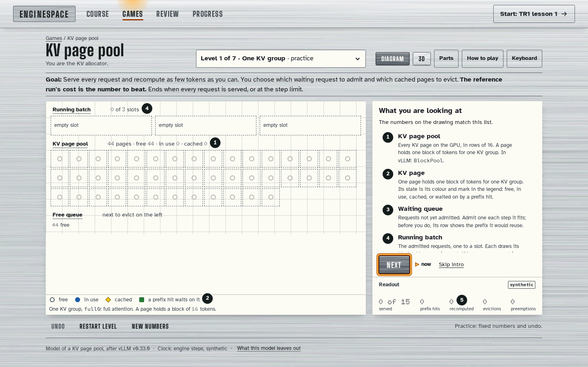<br>Build A, `094089c` | 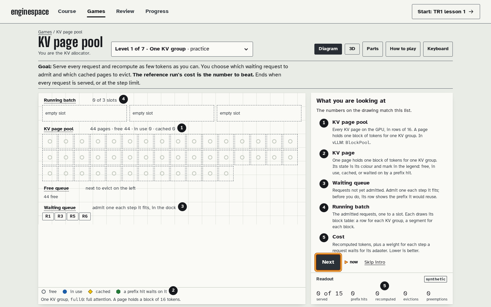<br>Build B, `4cccff2` |

**390 x 844**

| Build A, The Pass | Build B, Data Book |
|---|---|
| 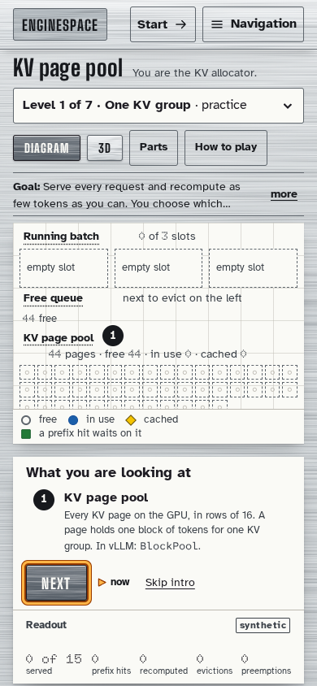<br>Build A, `094089c` | 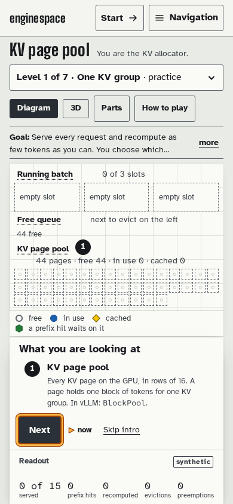<br>Build B, `4cccff2` |

### 4. TR5a lesson 1, midway in Read

Route `/m/tr5a/l1-why-one-model-needs-several-kv-caches`. Scrolled so that the middle of the Read section is the middle of the viewport.

**1440 x 900**

| Build A, The Pass | Build B, Data Book |
|---|---|
| 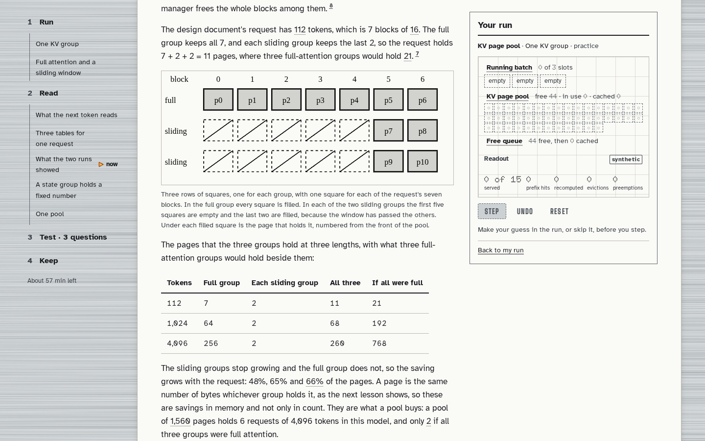<br>Build A, `094089c` | 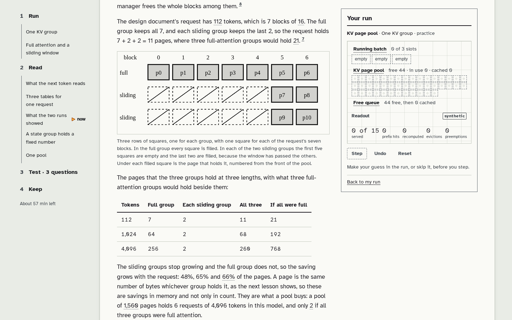<br>Build B, `4cccff2` |

**390 x 844**

| Build A, The Pass | Build B, Data Book |
|---|---|
| 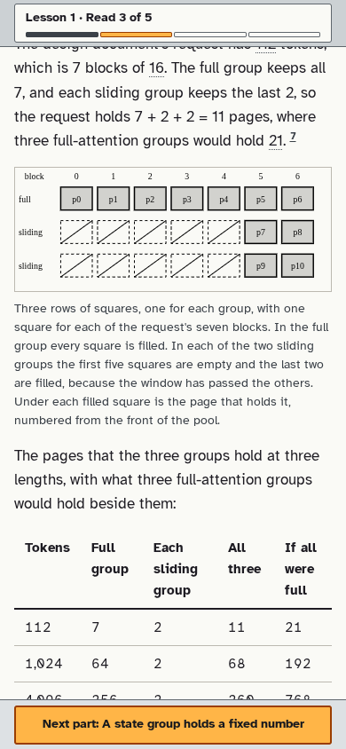<br>Build A, `094089c` | 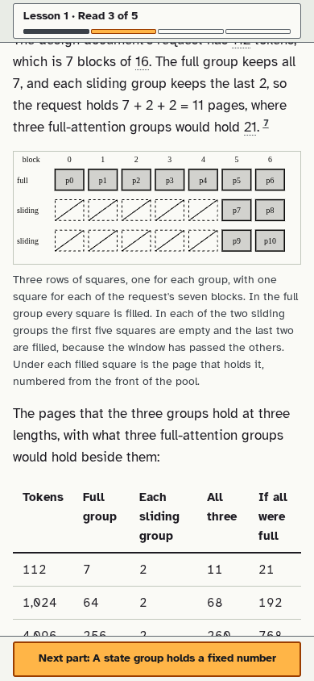<br>Build B, `4cccff2` |

### 5. The step loop on demo level 3, async scheduling on

Route `/play/loop?level=first-3-gap`. The intro skipped, then the async scheduling switch turned on. Both images are shot from the top of the page.

**1440 x 900**

| Build A, The Pass | Build B, Data Book |
|---|---|
| 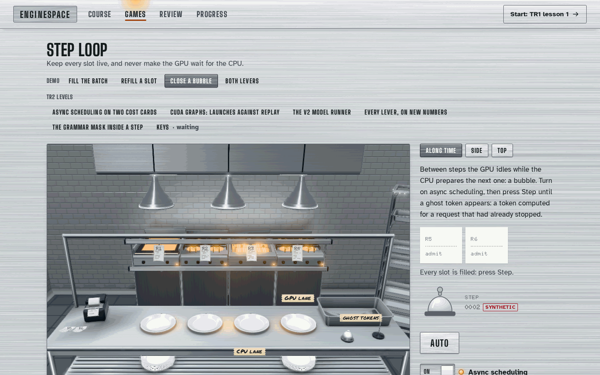<br>Build A, `094089c` | 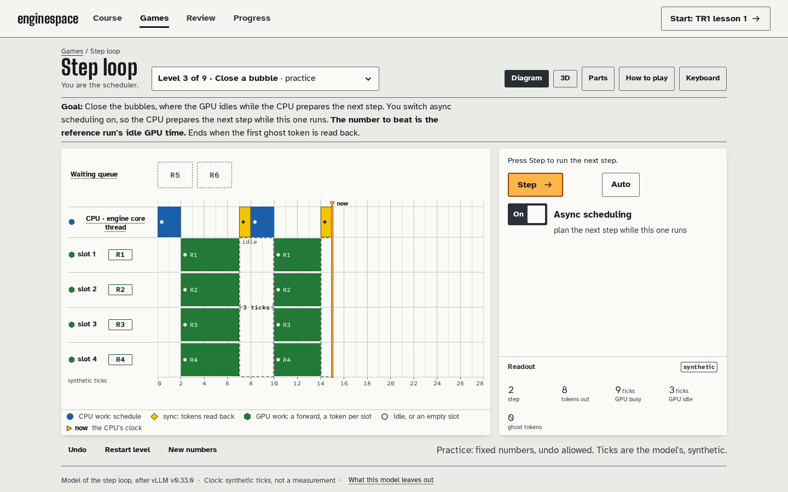<br>Build B, `4cccff2` |

**390 x 844**

| Build A, The Pass | Build B, Data Book |
|---|---|
| 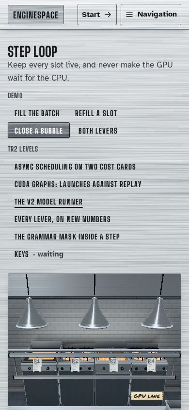<br>Build A, `094089c` | 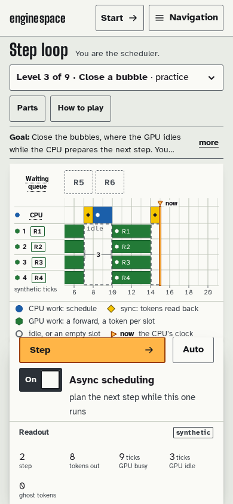<br>Build B, `4cccff2` |

## 5. The three questions

The owner has not answered these three, and the cold test asks them again.

Answer in your own words, after you have spent time in both. The same three are asked again in the cold test.

1. **Which of these would you rather spend an hour in?**

   Your words:

   &nbsp;

2. **Name one moment you would show someone.**

   Your words:

   &nbsp;

3. **Where did it feel like work with no payoff?**

   Your words:

   &nbsp;

## 6. The decision

**Data Book replaces The Pass.** The default, if you do not answer, is Data Book. Stage 3, which does not depend on the look, goes on meanwhile. Stage 4, the deletions, starts when you answer or when stage 3 has merged, whichever comes first.

**If you choose Data Book (or do not answer):** the wave goes on from build B. The three faces leave with the look.

**If you choose The Pass:** the wave restores from the tag `wave-r-stage1`. Stage 2's tokens, faces, time track and front page are not merged. The timing diagram stays as the step loop's 2D view. The kitchen stays as its 3D scene only, with engine words on every label. The pool and the sampler keep their 3D behind the switch, with 2D as the default. Stage 4 shrinks to three tasks.

Your answer: **Data Book**, given on 2026-11-16, in the owner's words: "data book for sure".
