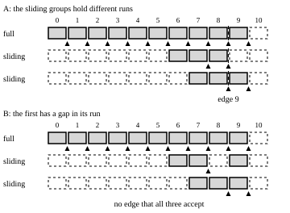

# A prefix hit must hold in every group

_Hybrid KV groups, and adapter pages in one pool · lesson `tr5a.l3` · review · about 72 minutes [estimated]_

Builds on kernelspace: `ks:T5.L6`, `ks:T5.L5`, `ks:t5.prefix-cache-keys`, `ks:t5.radix-eviction`, `ks:t2.eviction-policies`.

Knowledge components: `tr5a.hit-intersection`.

In kernelspace T5.L6 a prefix hit was the longest run of blocks from the start of a prompt that the cache still held, and with one table it is a loop that stops at the first miss. With several groups the hit has a second question to answer. The request's first new token will read every layer, and each kind of layer reads the cache differently.

## What each group needs at the edge

Say that a prompt shares its first `m` blocks with a cached sequence. The request starts computing at the token after them, which is the **edge** of the hit. Every layer then reads the cache as it will for that token, and each kind of group needs different blocks to be there.

- A **full** group reads every earlier token, so it needs blocks `0` to `m - 1`, every one of them.
- A **sliding** group reads only the last window before the edge, so it needs the `ceil((W - 1) / B)` blocks just before the edge. When fewer than that come before the edge, it needs them all, from the first. **ceil((window - 1) / block size)** [measured] **the cached run at the start** [measured]
- A **state** group reads the state at the edge, so it needs the one block that holds it. **the last cached block** [measured]

So each group accepts some edges and rejects the rest, and the request's hit is an edge that every group accepts. It is the **intersection** of what the groups hold. **the intersection of the groups' hits** [measured] The cache is keyed by a block's hash and its group, so the same tokens in two groups are cached, and evicted, independently of each other. **(block hash, group id)** [measured]

A full group's accepted edges are downward-closed: if it accepts an edge it accepts every edge before it. A window's are not. It accepts an edge only if the blocks just before that edge are cached, so its accepted edges can have gaps, once a block in the middle of its run has been evicted. That is why a hit cannot be found by asking each group for its longest hit and taking the shortest. A state group is the other extreme: it needs one block and no run, so its accepted edges are scattered, wherever a state was saved. Commit to two predictions before you play.

> **Predict `tr5a.l3.p1`.** The model is lesson 1's, one full group and two sliding-window groups, with 16 tokens in a block [estimated] and a 32-token window [estimated]. A returning request has a prompt of 176 tokens [estimated], and its blocks are counted from the first. The full group holds the blocks numbered 0 to 9 [estimated]. The first sliding group holds the blocks 6 to 8, and the second holds the blocks 7 to 9 [estimated], because the two groups cache and evict their blocks independently. How many tokens does the prefix hit cover?
>
> The learner commits to a number in `tokens`, graded within a relative tolerance of `0` [estimated] before the reveal. Ask them to commit to an answer and say why before you discuss it.

> **Predict `tr5a.l3.p2`.** The model is the `state` level's, one full group and three state groups, with 32 tokens in a block [estimated]. A returning request has a prompt of 330 tokens [estimated]. The full group holds the blocks numbered 0 to 7 [estimated]. Each state group holds only the blocks 2 and 5 [estimated], which are the states at two edges. How many tokens does the prefix hit cover?
>
> The learner commits to a number in `tokens`, graded within a relative tolerance of `0` [estimated] before the reveal. Ask them to commit to an answer and say why before you discuss it.

In The Reach-In the free queue is **the rotation**, evicting a page is **dumping a pan**, and a prefix hit is **shared mise**. A ticket's hit counts only as far as every station still holds its pans, and `evict` is the level where you choose which pans to dump.

> **Play.** The game `pool`, level `evict`, in `practice` mode. It runs in the lesson. Ask the learner to play it before you discuss it: its reference run stays hidden until the debrief.

## How the engine finds the hit

The engine runs a loop over the groups.

1. Start from the longest candidate: the prompt less its last token, rounded down to a block.
2. Ask each group, full attention first, for its longest accepted edge not above the candidate.
3. If any group lowered the candidate, ask all of them again. When a whole pass changes nothing, the candidate is the hit. It only falls and stops at zero, so the loop ends. **iterative fixed point** [measured]

Three details keep the loop short.

- Full attention goes first, because its scan from the left gives the tightest first bound. **full attention first** [measured]
- A window is scanned from the right, from the candidate down, so that it can stop at the first edge it accepts. **full left to right, window right to left** [measured]
- Full attention is downward-closed, so its blocks are looked up once, and the later passes only trim its hit to the candidate. **full attention is downward-closed** [measured]

With one full group and one other group, the first pass settles it. **one pass** [measured]

Two more rules bound the answer.

- A hit is a multiple of the least common multiple of the groups' block sizes, which is why a bigger block makes a coarser hit. **a multiple of the scheduler block size** [measured]
- A hit never covers the last token of the prompt, because the request computes it to get its logits, even if that recomputes a whole block. **the prompt length less 1** [measured]

Here are two caches for the prompt of the prediction. Each row is a group, each square one of the prompt's eleven blocks, and a filled square is a block that the group has cached. A mark under a row is an edge that the group accepts.

_Two panels, each with three rows of squares for the full group and the two sliding groups. In the first panel the full group has the first ten blocks cached, the first sliding group has the blocks numbered six to eight, and the second sliding group the blocks numbered seven to nine. The groups accept edges that overlap at one place, and a vertical line marks it. In the second panel the first sliding group is missing a block in the middle of its run, and the edges that the three groups accept have no place in common._

In the first cache the full group accepts the edges 1 to 10, the first sliding group 8 and 9, and the second 9 and 10, so the hit is the edge 9, which is 144 tokens [derived]. In the second the first sliding group has lost a block in the middle of its run, and holds blocks 6, 7 and 9 [estimated]. It accepts only the edge 8, the second accepts 9 and 10, and no edge is common to all three, so the hit is 0 tokens [derived], though the full group holds 160 tokens and each sliding group holds blocks. Both tempting answers are wrong there. The union of the groups' longest hits is 160 tokens, which the first sliding group cannot serve, and the shortest of the groups' longest hits is 128 tokens, which the second cannot serve [derived]. A hit that a group cannot serve makes that group read blocks that are not there.

In the second prediction a state group accepts an edge when the one block before it is cached, so the three state groups accept the edges 3 and 6 [derived]. The full group accepts every edge up to 8, so the hit is the edge 6, which is 192 tokens [derived]. The same loop finds it, and a state group needs no run of blocks to accept an edge, only the one that holds its state.

SGLang gets to the same rule from the other side. Its unified radix cache holds the full, sliding-window and Mamba components in one tree, and the deepest node counts as a match only if every component's validator accepts it. **Full, SWA and Mamba on one tree** [measured] **the deepest node that every component accepts** [measured] A tree of tokens and a pool of hashed blocks are different structures that answer one question the same way.

> **Leapfrog intersection.** A search engine answers an AND query by intersecting the posting lists of its terms, and the quick way never builds a list in full. Each list jumps to the first document it holds at or after the candidate, whichever list overshoots moves the candidate, and the loop ends when all of them agree. The hit loop is that, running down from the longest candidate.
>
> Where it breaks: Posting lists are fixed sets. Here a group's accepted edges depend on what the cache holds at that moment, and the same tokens in two groups are cached and evicted independently, so one group can lose an edge that another keeps.

> **The union is not a hit.** A hit that is the longest of any one group, or the shortest of the groups' longest, can name an edge that some group cannot serve. The answer is the largest edge that every group accepts, and it is zero when there is none.

## What the rule does to eviction

One free queue serves every group, and four rules say who leaves it first. **one LRU queue** [measured]

- A block joins the queue at the back when it has a hash and at the front when it has none. **unhashed to the front, hashed to the back** [measured]
- A request's blocks go back last block first, so that the tail of a prefix is evicted before its head. **last block first** [measured]
- A new block takes the front of the queue, and loses its hash if it had one. **from the front of the free queue** [measured]
- A hit takes the pages it uses out of the queue, so a block that a request holds cannot be evicted. **leaves the free queue** [measured]

Put the hit rule on top of that order and each cached block has a price. Evicting the first block of a full group's prefix kills every hit that would have started from it, and evicting its tail only shortens them. A block deep inside a sliding group's long prefix is needed only by a request that shares just that part of the prefix, and a later turn of the same session resumes from the end. The blocks of the last window before that edge are vital, and evicting one of them, as in the second cache, can cost the whole hit. When a ticket needs room, `evict` asks you which cached pans to dump, and the rule above is what makes some of them dear.

> **Card.** The notional-machine card `kv`.

## Read it at the pin

The lookup is `HybridKVCacheCoordinator.find_longest_cache_hit` in [`kv_cache_coordinator.py`](https://github.com/vllm-project/vllm/blob/v0.33.0/vllm/v1/core/kv_cache_coordinator.py), and each kind of group scans for its own hit in its manager in [`single_type_kv_cache_manager.py`](https://github.com/vllm-project/vllm/blob/v0.33.0/vllm/v1/core/single_type_kv_cache_manager.py). vLLM's own tests run the lookup on groups of 2, 3 and 4 in many mixes [measured], in [`test_prefill_hybrid_model_combinations`](https://github.com/vllm-project/vllm/blob/v0.33.0/tests/v1/core/test_prefix_caching.py#L2397), and they are a good source of cases for your own checks. **groups of 2, 3 and 4** [measured] The design document still says that the coordinator handles exactly two groups. It was written at an earlier commit, and the code and the tests are the authority. **2 groups** [measured]

## Build

Stage four of the lab is this rule in Rust. `hit_all_groups` (`s4`) plays a prompt at your manager and judges the hit it finds against the longest edge that every group holds. A manager that returns the longest hit of any one group, a hit that covers the last token of the prompt, or one that ends inside a block fails it.

> **Build.** The lab `hybrid-kv` (lane B), stage `s4`. The lab page grades it.

## What to carry

- A hit is an edge that every group accepts: blocks `0` to `m - 1` for full attention, the window's blocks before the edge for a sliding group, the one state block for a state group.
- A window's accepted edges can have gaps, so the longest hit of the shortest group is not the answer. Loop until a pass changes nothing.
- A hit is a multiple of the least common multiple of the groups' block sizes, and it stops short of the last token.
- Evicting the head of a full group's prefix, or a window's blocks before the next edge, costs the most.

## Exit check

This lesson tests one skill: working out the longest prefix hit when every group must hold it, and saying why the answer is an intersection and not a union (`tr5a.hit-intersection`). The exit ticket is three items on fresh seeds, each a prompt with the blocks that every group holds, asking for the tokens the hit covers. It is passed with at least two right, one of them numeric (ASSESSMENT §4.2). The graded `evict` level then asks you to use the rule under pressure: a score of at least 0.95 [estimated] of the house's, on 3 fresh seeds [estimated] (ASSESSMENT §4.3). The lab's stage `hit_all_groups` grades the skill again on seeds drawn when you run it.

> **Practice.** Items from the generator family `tr5a.hit-length`, level `2`, `3` per attempt, drawn on fresh seeds in the lesson. Ask the learner to answer before you discuss one.

> **Play.** The game `pool`, level `evict`, in `graded` mode. It runs in the lesson. Ask the learner to play it before you discuss it: its reference run stays hidden until the debrief.

## Claims cited

- `sglang.radix.all-validators`: SGLang's Rust tree core, which is the default core, takes as the best match the deepest node that all of the components' validators accept. Value the deepest node that every component accepts [measured], checked 2026-11-05 (source: SGLang v0.5.23, rust/sglang-radix-tree/src/unified_tree_core.rs, MatchResult.best_match_node_id <https://github.com/sgl-project/sglang/blob/v0.5.23/rust/sglang-radix-tree/src/unified_tree_core.rs#L140-L143>, read 2026-11-05).
- `sglang.radix.unified-cache`: The Rust core serves the Unified Radix Cache, one tree that covers full attention, sliding-window attention and Mamba components. It implements the tree side only, match and insert walks, the node arena, locks and eviction walks, and Python keeps the physical KV allocation. Value Full, SWA and Mamba on one tree [measured], checked 2026-11-04 (source: SGLang v0.5.23, rust/sglang-radix-tree/README.md <https://github.com/sgl-project/sglang/blob/v0.5.23/rust/sglang-radix-tree/README.md#L3>, read 2026-11-04).
- `vllm.hybrid-kv.cache-key`: The block pool caches full blocks in a dict keyed by the pair of a block hash and a group id, so the same tokens in different groups are cached and evicted independently. Value (block hash, group id) [measured], checked 2026-11-04 (source: vLLM v0.33.0, docs/design/hybrid_kv_cache_manager.md (Prefix caching) <https://github.com/vllm-project/vllm/blob/v0.33.0/docs/design/hybrid_kv_cache_manager.md#L163>, read 2026-11-04).
- `vllm.hybrid-kv.doc-two-groups`: The design document describes HybridKVCacheCoordinator as handling exactly two KV cache groups, one full-attention group and one other, and says other cases are not implemented. The code does more than that, as the next claim shows, so the document is stale on the number of groups. Value 2 groups [measured], checked 2026-11-04 (source: vLLM v0.33.0, docs/design/hybrid_kv_cache_manager.md (Overview) <https://github.com/vllm-project/vllm/blob/v0.33.0/docs/design/hybrid_kv_cache_manager.md#L221>, read 2026-11-04).
- `vllm.hybrid-kv.downward-closed`: The hybrid coordinator's lookup treats full attention as downward-closed, so it looks up the cached blocks of a full-attention group once, and on the later passes of its loop only trims that group's hit to the candidate length. The other groups get no such shortcut, and are asked again on every pass. Value full attention is downward-closed [measured], checked 2026-11-05 (source: vLLM v0.33.0, vllm/v1/core/kv_cache_coordinator.py, HybridKVCacheCoordinator.find_longest_cache_hit <https://github.com/vllm-project/vllm/blob/v0.33.0/vllm/v1/core/kv_cache_coordinator.py#L856-L901>, read 2026-11-05).
- `vllm.hybrid-kv.full-attention-first`: The coordinator puts the full-attention groups first in its lookup, because their left-to-right scan gives a tighter first bound for the groups after them. Value full attention first [measured], checked 2026-11-04 (source: vLLM v0.33.0, vllm/v1/core/kv_cache_coordinator.py, HybridKVCacheCoordinator.verify_and_split_kv_cache_groups <https://github.com/vllm-project/vllm/blob/v0.33.0/vllm/v1/core/kv_cache_coordinator.py#L756-L760>, read 2026-11-04).
- `vllm.hybrid-kv.full-plus-sliding-lookup`: For full attention plus sliding window the lookup first finds the longest full-attention hit scanning left to right, and then the longest sliding-window hit inside that length, checking from right to left. Value full left to right, window right to left [measured], checked 2026-11-04 (source: vLLM v0.33.0, docs/design/hybrid_kv_cache_manager.md (Case 2) <https://github.com/vllm-project/vllm/blob/v0.33.0/docs/design/hybrid_kv_cache_manager.md#L196-L197>, read 2026-11-04).
- `vllm.hybrid-kv.hit-alignment`: A prefix hit is aligned to the scheduler block size, so the longest hit that every group can serve is rounded down to a multiple of the least common multiple of the groups' block sizes. Value a multiple of the scheduler block size [measured], checked 2026-11-04 (source: vLLM v0.33.0, vllm/v1/core/kv_cache_coordinator.py, HybridKVCacheCoordinator._align_cacheable <https://github.com/vllm-project/vllm/blob/v0.33.0/vllm/v1/core/kv_cache_coordinator.py#L777-L787>, read 2026-11-04).
- `vllm.hybrid-kv.intersection`: On a new request the manager checks the cache-hit prefix of each group and returns the intersection of the groups as the request's cached prefix. Value the intersection of the groups' hits [measured], checked 2026-11-04 (source: vLLM v0.33.0, docs/design/hybrid_kv_cache_manager.md (Prefix caching) <https://github.com/vllm-project/vllm/blob/v0.33.0/docs/design/hybrid_kv_cache_manager.md#L165>, read 2026-11-04).
- `vllm.hybrid-kv.mamba-hit`: A Mamba group looks from the right for the last block that is cached and hits there, so a hit at a block's edge needs that one block, which holds the state at the edge, and no others. Value the last cached block [measured], checked 2026-11-04 (source: vLLM v0.33.0, vllm/v1/core/single_type_kv_cache_manager.py, MambaManager.find_longest_cache_hit <https://github.com/vllm-project/vllm/blob/v0.33.0/vllm/v1/core/single_type_kv_cache_manager.py#L1522-L1546>, read 2026-11-04).
- `vllm.hybrid-kv.n-group-lookup`: At v0.33.0 HybridKVCacheCoordinator.find_longest_cache_hit handles a list of attention types, not only two, with an iterative fixed-point algorithm. Each type either accepts the candidate length or shortens it, and any shortening restarts the pass over all the types. The loop converges because the length only falls and stops at 0. Value iterative fixed point [measured], checked 2026-11-04 (source: vLLM v0.33.0, vllm/v1/core/kv_cache_coordinator.py, HybridKVCacheCoordinator.find_longest_cache_hit <https://github.com/vllm-project/vllm/blob/v0.33.0/vllm/v1/core/kv_cache_coordinator.py#L811-L816>, read 2026-11-04).
- `vllm.hybrid-kv.one-lru`: The design document says all KV cache groups share one LRU queue. Blocks join it when they are freed, either because the request finished or because the block fell out of the sliding window. Value one LRU queue [measured], checked 2026-11-04 (source: vLLM v0.33.0, docs/design/hybrid_kv_cache_manager.md (Case 2) <https://github.com/vllm-project/vllm/blob/v0.33.0/docs/design/hybrid_kv_cache_manager.md#L203>, read 2026-11-04).
- `vllm.hybrid-kv.simple-hybrid`: When a model has exactly one full-attention group and one other group, the lookup needs one iteration, and full attention is always checked first when it exists. Value one pass [measured], checked 2026-11-04 (source: vLLM v0.33.0, vllm/v1/core/kv_cache_coordinator.py, HybridKVCacheCoordinator.find_longest_cache_hit <https://github.com/vllm-project/vllm/blob/v0.33.0/vllm/v1/core/kv_cache_coordinator.py#L836-L837>, read 2026-11-04).
- `vllm.hybrid-kv.sliding-hit-blocks`: A prefix hit in a sliding-window group needs the blocks that the window covers before the edge of the hit, which are the ceiling of (window - 1) divided by the block size of them in a row. Value ceil((window - 1) / block size) [measured], checked 2026-11-04 (source: vLLM v0.33.0, vllm/v1/core/single_type_kv_cache_manager.py, SlidingWindowManager._contiguous_blocks_for_hit <https://github.com/vllm-project/vllm/blob/v0.33.0/vllm/v1/core/single_type_kv_cache_manager.py#L956-L966>, read 2026-11-04).
- `vllm.hybrid-kv.sliding-hit-prefix`: When no run of enough blocks is cached, a sliding-window group still hits on the cached run that starts at the first block, even if it is shorter than the window needs, because the window then reaches back to the start of the prompt. Value the cached run at the start [measured], checked 2026-11-04 (source: vLLM v0.33.0, vllm/v1/core/single_type_kv_cache_manager.py, SlidingWindowManager.find_longest_cache_hit <https://github.com/vllm-project/vllm/blob/v0.33.0/vllm/v1/core/single_type_kv_cache_manager.py#L1040-L1044>, read 2026-11-04).
- `vllm.hybrid-kv.upstream-hybrid-tests`: vLLM's own test of prefix caching on hybrid models, test_prefill_hybrid_model_combinations, runs the lookup on groups of 2, 3 and 4, with 0, 1 or 2 full-attention groups among them, two sliding-window groups with different window sizes, interleaved group ids, and Mamba beside the other types. Value groups of 2, 3 and 4 [measured], checked 2026-11-05 (source: vLLM v0.33.0, tests/v1/core/test_prefix_caching.py, test_prefill_hybrid_model_combinations <https://github.com/vllm-project/vllm/blob/v0.33.0/tests/v1/core/test_prefix_caching.py#L2397-L2411>, read 2026-11-05).
- `vllm.kv-pool.allocate-from-front`: New blocks come from the front of the free queue, and a block that is taken while it still has a hash loses the hash, which is an eviction. Value from the front of the free queue [measured], checked 2026-11-04 (source: vLLM v0.33.0, vllm/v1/core/block_pool.py, BlockPool.get_new_blocks <https://github.com/vllm-project/vllm/blob/v0.33.0/vllm/v1/core/block_pool.py#L706-L740>, read 2026-11-04).
- `vllm.kv-pool.free-order`: When the last holder of a block lets go, the pool puts a block with no hash at the front of the free queue, where it is reused first, and a block with a hash at the back, so that cached blocks leave in least-recently-used order. The blocks go in the order the caller gives. Value unhashed to the front, hashed to the back [measured], checked 2026-11-04 (source: vLLM v0.33.0, vllm/v1/core/block_pool.py, BlockPool.free_blocks <https://github.com/vllm-project/vllm/blob/v0.33.0/vllm/v1/core/block_pool.py#L816-L849>, read 2026-11-04).
- `vllm.kv-pool.free-reverse`: A request's blocks are freed in reverse order, so that the tail blocks go back first and, among blocks with hashes, are evicted before the head of the same prefix. Value last block first [measured], checked 2026-11-04 (source: vLLM v0.33.0, vllm/v1/core/single_type_kv_cache_manager.py, SingleTypeKVCacheManager.free <https://github.com/vllm-project/vllm/blob/v0.33.0/vllm/v1/core/single_type_kv_cache_manager.py#L591-L599>, read 2026-11-04).
- `vllm.kv-pool.max-hit-length`: A prefix hit never covers the whole prompt. The manager caps it at the prompt's length less 1, so that the last token is computed and gives the logits, even if that recomputes a whole block. Value the prompt length less 1 [measured], checked 2026-11-04 (source: vLLM v0.33.0, vllm/v1/core/kv_cache_manager.py, KVCacheManager.get_computed_blocks <https://github.com/vllm-project/vllm/blob/v0.33.0/vllm/v1/core/kv_cache_manager.py#L295-L302>, read 2026-11-04).
- `vllm.kv-pool.touch`: A request that hits a cached block touches it. If nobody else holds the block it is in the free queue as an eviction candidate, and the touch removes it from there, so it cannot be evicted while the request holds it. Value leaves the free queue [measured], checked 2026-11-04 (source: vLLM v0.33.0, vllm/v1/core/block_pool.py, BlockPool.touch <https://github.com/vllm-project/vllm/blob/v0.33.0/vllm/v1/core/block_pool.py#L792-L810>, read 2026-11-04).
